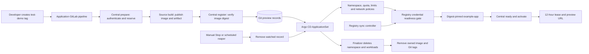
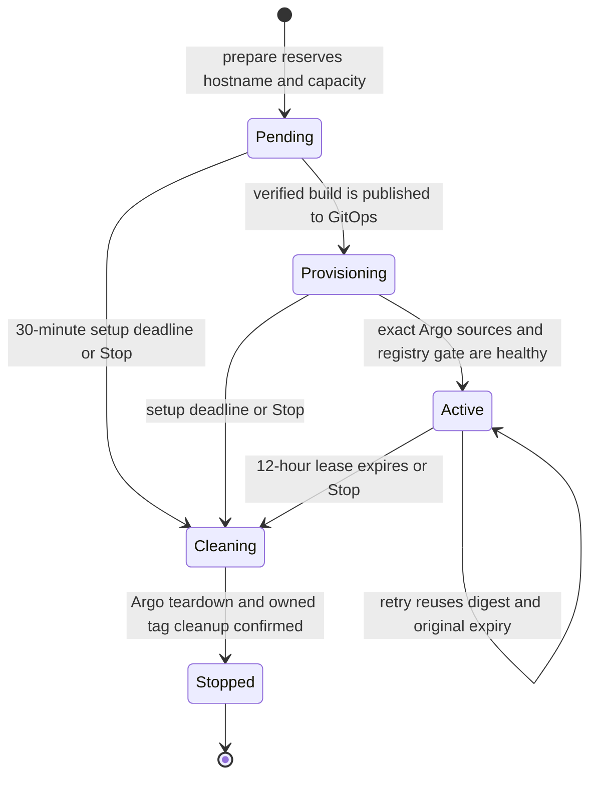

# GitOps Preview Environments

Create disposable application previews from GitLab test tags. GitLab CI verifies
requests and records state in Git; Argo CD deploys an isolated Kubernetes namespace
and a digest-pinned application. A cluster CronJob cleans up expired previews.

This repository can be hosted publicly on GitHub. **The deployment workflow runs
on GitLab** and needs a GitLab copy of this platform plus a separate application
project. It does not deploy from GitHub Actions.

The included **Company / `example-app`** is a small Python HTTP server with no
third-party runtime dependencies, database, queue, or persistent volume. All
`company.example` addresses, numeric project IDs, zero SHA values and image
references are examples. The catalog is disabled until an operator configures and
approves it. There is no production deployment configuration or credential file.

## Architecture



GitLab deployment jobs use HTTPS APIs and **do not receive Kubernetes credentials**.
The source build uses its own job/registry credentials. Central API credentials,
Argo Git access and the cluster registry pull Secret are configured separately.

## Run the example locally

Requires Python 3.11 or newer:

```sh
python3 examples/example-app/server.py
# In another terminal:
curl http://localhost:8080/
curl http://localhost:8080/health
curl http://localhost:8080/healthz
```

Or build the container:

```sh
docker build -t example-app:local examples/example-app
docker run --rm -p 8080:8080 --read-only --cap-drop=ALL example-app:local
```

The sample returns application name, Company, build version and a source-code link.
Set your actual source URL in `charts/example-app/values.yaml` before distribution.

## What is included

| Path | Purpose |
| --- | --- |
| `scripts/preview.py` | Authenticated prepare, register, readiness, activation, Stop and cleanup |
| `config/platform.json` | Trusted GitLab, Argo CD, repository and DNS settings |
| `catalog/example-app.json` | Disabled source/image/chart approval catalog |
| `provisioning/` | Reviewed ingress and DNS-only egress policy |
| `charts/previews/` | Namespace, quotas, limits, deny policy, registry RBAC and gate |
| `charts/example-app/` | Non-root HTTP workload, Service and Ingress |
| `platform/bootstrap/` | AppProject, ApplicationSet, admission policies and controllers |
| `platform/registry-sync/` | Registry Secret synchronizer, readiness Lua script and tests |
| `tools/` | Source build helper and tools-image Dockerfile |
| `examples/example-app/` | Copyable application project, Dockerfile, tests and GitLab CI |
| `.gitlab-ci.yml` | Platform validation and trusted lifecycle pipeline |
| `.github/workflows/validate.yml` | Public contribution validation and secret scanning |
| `pending/`, `previews/`, `requests/`, `cleanup/`, `archive/` | Empty runtime state directories |

## Install on your infrastructure

Follow [the installation guide](docs/installation.md) for prerequisites, project
setup, credentials, the tools image and bootstrap order. The example needs:

- A Kubernetes cluster with stable ValidatingAdmissionPolicy support (1.30+) and
  a network-policy-capable CNI.
- Argo CD with ApplicationSet and multiple-source Applications; an ingress
  controller, wildcard DNS and HTTPS configured by the operator.
- Two GitLab projects, a container registry and isolated CI runners. The source
  build example uses Docker-in-Docker with TLS.

The public source is a starting point, not a record of a verified cluster rollout.
Review the admission rules and credentials for your environment before enabling it.

## Preview lifecycle



Create a fresh supported tag such as `test-demo` from the application commit you
want to preview. The application pipeline runs `prepare:test`, `build:test`,
`deploy:test` and `report:test`. The report prints its URL, namespace and expiry.
Supported tags match `^test[-.]?[a-z0-9]+([._-][a-z0-9]+)*$` and are at most 128
characters long.

For source project `100`, pipeline `12345` and SHA starting `abc`, the example
creates namespace `test-example-app-100-12345` and host
`test-abc-example-app.company.example`. The short host suffix has a limited name
space; collisions fail without replacing an existing preview. Environments use
`test/example-app-<project>-<full SHA>`.

Each source project has a fixed limit of **three** pending, provisioning or active
previews, including previews still waiting for namespace teardown. Repeated
requests reuse the canonical preview without extending its deadline or lease.
The reaper requests a sweep every five minutes; deletion is asynchronous.

To stop early, open **New pipeline** in the application project, choose `stop` for
`TEST_PREVIEW_ACTION`, and set `TEST_PREVIEW_PIPELINE_ID` to the **original source
pipeline ID**. This starts only the Stop bridge and remains available when new
previews are disabled. A successful request precedes actual namespace deletion.
The central environment also exposes its manual Stop job.

Cleanup removes the preview-owned image tag and the original test Git tag only
after safe ownership checks and confirmed Argo deletion. Source branches and
commits remain. See [operations and acceptance checks](docs/operations.md).

## Validate changes

Install Python 3.11+, Helm 3 and a Lua 5.2 or 5.4 shared library, then run:

```sh
python3 -m venv .venv
. .venv/bin/activate
pip install -r requirements-dev.txt
python3 -B scripts/validate.py
```

Validation checks JSON/YAML, lifecycle and authorization behavior, source build
metadata, registry delivery, Lua health, both charts and application endpoints.
No deployment or credential is needed. Lua tests report a skip if its library is
missing; Helm is required for full validation.

See [security and publication notes](SECURITY.md) for secret scans and credential
handling. The [verification report](docs/verification.md) distinguishes completed
offline checks from live acceptance work.

## License

[GNU Affero General Public License v3](LICENSE), retained from this repository.
